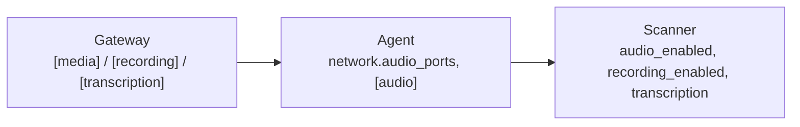

# Audio, recording and transcripts

!!! warning "Get legal sign-off first"
    Only monitor or record communications you are authorised to receive
    and retain. Every content feature is off by default, at every level.

Each feature has to be switched on in **three places**: the gateway, the
agent, and the individual scanner.

## Live listening

1. **Gateway:** add `[media]` with `udp_bind` and, behind NAT or with a
   wildcard bind, `public` (the address browsers can reach).
2. **Agent:** make sure the scanner's RTSP port is in
   `network.audio_ports` (default `[554]`).
3. **Scanner:** set `audio_enabled` (and `rtsp_port` if it is not 554).

Users need `audio_listen`. The agent is the scanner's **only** audio
client: it opens a session while someone listens and closes it about 15 s
after the last listener leaves.

## Recording

1. **Gateway:** add `[recording]` with a storage backend:
    - `s3`: enable bucket encryption at rest and restrict access to the
      gateway's identity;
    - `local`: a directory on the gateway host;
    - `memory`: development only.
2. **Scanner:** a `recording_manage` user turns on `recording_enabled`.

Recordings are Ogg Opus, one per transmission, with a short pre-buffer
and post-roll. Recording scanners stream continuously while their agent is
connected.

## Transcription

1. **Gateway:** add `[transcription]` (it needs `[recording]`):
    - `api = "whisper_cpp"` for whisper.cpp's `whisper-server`, or
      `"openai"` for any OpenAI-compatible service;
    - prefer a service on your own network. **A hosted service receives
      every recording you transcribe**;
    - HTTPS is required unless the host is loopback or `allow_http = true`.
2. **Scanner:** a `transcription_manage` user turns transcription on.

Clips shorter than `min_duration_ms` (default 600) are skipped. Scanner
audio is narrow-band and hard for every model; check quality before
relying on transcripts. Transcripts are searchable from the Transmissions
page.

## Retention

Set limits in `[retention]`, in days. An unset limit keeps data forever.

| Setting | Deletes |
|---|---|
| `recordings_days` | Audio objects |
| `transcripts_days` | Transcript text |
| `transmissions_days` | Transmission records (with their recordings and transcripts) |
| `events_days` | Scanner events |

- The audit log is never swept.
- Transmissions placed on **hold** are kept regardless.
- Every sweep writes one audit record per tenant.

## If a scanner's audio locks up

The SDS200's audio server is reported to hang if a session is not closed
cleanly. Disable audio for that scanner, power-cycle it, and raise
`audio.cooldown_secs` on the agent. See
[Protocol compliance → Audio](../protocol-compliance.md#audio-rtsp-rtp).
