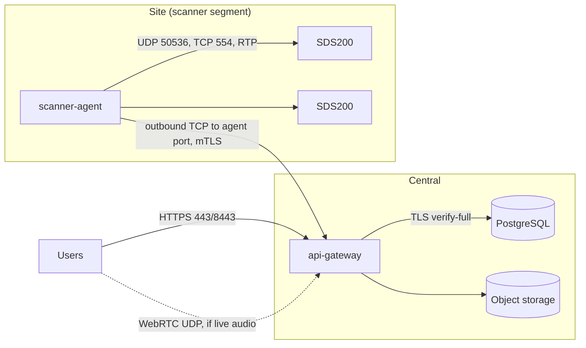

# Plan a deployment

## Components

| Component | Runs where | Listens on | Notes |
|---|---|---|---|
| `api-gateway` | Central (VM, container or Kubernetes) | Public HTTPS API and console (TLS 1.3); agent listener (TLS 1.3 + client certificates) | One replica by default; several with `[cluster] enabled = true` |
| `scanner-agent` | One per site, on the scanner network segment (an ARM64 Raspberry Pi-class host is enough) | **Nothing**; it dials out | Up to `max_scanners` (default 32) per agent |
| PostgreSQL ≥ 14 | Central | | Holds everything except recordings |
| Object storage (optional) | Central | | S3-compatible or a local directory, for recordings |
| Transcription service (optional) | Ideally on your own network | | whisper.cpp `whisper-server` or any OpenAI-compatible endpoint |
| Identity provider | Your existing IdP | | OIDC; issues access tokens with tenant, site and role claims |

## Network layout

Firewall rules:

- **Never expose UDP 50536 or TCP 554** beyond the scanner segment. The
  scanner protocol has no authentication or encryption.
- Agents need **outbound TCP to the gateway's agent port only** (9443 in
  the example configuration).
- A load balancer in front of the agent port needs **TCP passthrough**,
  because agents use mutual TLS end to end.
- For live audio, browsers must reach the gateway's WebRTC UDP port on
  the replica that holds the agent.
- Keep the `[metrics]` listener internal; it has no authentication.

## Certificates (PKI)

You need two things from your PKI:

1. An **agent CA** that issues one client certificate per agent.
    - The first DNS SAN (or the CN if there is no SAN) is the agent's ID,
      for example `site-a-agent-1`.
    - Extended key usage `clientAuth`.
    - Publish a CRL and point `agents.client_crl` at it. An expired CRL
      refuses **every** agent, so automate re-publication.
2. A **gateway server certificate** whose SANs match the host in each
   agent's `gateway.url`, with extended key usage `serverAuth`.

Keep the agent CA key offline. See
[Deployment → PKI requirements](../deployment.md#pki-requirements).

## Identity provider

Register a **public** OIDC client for the console (authorization code with
PKCE, no secret), with redirect URI `https://<console host>/auth/callback`.
Access tokens must carry:

| Claim (default name) | Content |
|---|---|
| `aud` | The gateway's `auth.audience` |
| `tenant_id` | The tenant UUID |
| `sites` | Array of site UUIDs, or `["*"]` (absent means all) |
| `roles` | Role names, mapped to permissions in the gateway configuration |

Refresh tokens are recommended; tokens are held in memory only.

## Database

- PostgreSQL 14 or later. Migrations run automatically at gateway start-up.
- Off-loopback connections **must** use `sslmode=verify-full`, or the
  gateway refuses to start. See
  [Deployment → Database TLS](../deployment.md#database-tls).

## Sizing

The hot paths are measured in [Benchmarks](../benchmarks.md). In practice
the database dominates: size it for your fleet's event and transmission
rates and set [retention](audio-and-recording.md#retention) so tables stay
bounded.

## Pre-deployment checklist

- [ ] Scanner segment isolated; only the agent host can reach the scanners
- [ ] Agent CA, CRL and gateway certificate issued
- [ ] OIDC client registered and claims mapped
- [ ] PostgreSQL provisioned with TLS (`verify-full`)
- [ ] Decision taken, with legal input, on audio, recording, transcription
      and retention
- [ ] One pilot scanner available for the hardware sign-off
