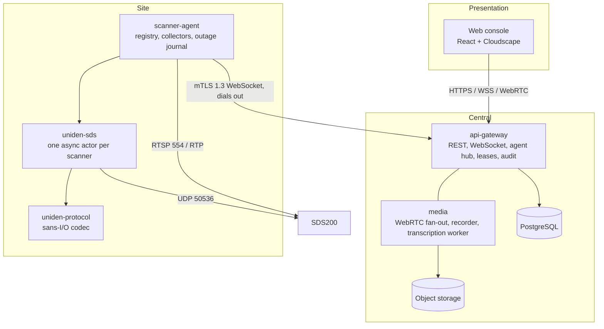

# Architecture

This section is for engineers, security reviewers and anyone who needs to
know how Radio Platform is built and why.

## In one picture

## Principles

- **Layered.** The protocol codec has no I/O; the SDK owns sockets; domain
  logic sits above it; services and the console on top
  ([ADR 0001](../decisions/0001-sans-io-protocol-crate.md)).
- **One command in flight per scanner.** The protocol has no request IDs,
  so each scanner gets a serialized actor
  ([ADR 0002](../decisions/0002-serialized-actor-per-scanner.md)).
- **Know where every fact comes from.** Each command carries its
  provenance and verification level
  ([ADR 0003](../decisions/0003-provenance-tracking.md)).
- **Sites dial out.** Agents connect to the gateway over mutual TLS, so
  sites need no inbound ports
  ([ADR 0004](../decisions/0004-agent-dials-out-over-mtls-websocket.md)).
- **The agent has the last word on the network.** It checks every
  scanner endpoint against its own local policy
  ([ADR 0005](../decisions/0005-agent-enforces-network-policy.md)).
- **Never retry a state change.** Only read-only commands are retried.
- **Bounded everything.** Queues, buffers, parsers and XML are limited;
  scanner input is untrusted.
- **Tamper-evident audit.** Audit records form a hash chain
  ([ADR 0011](../decisions/0011-tamper-evident-audit.md)).

## Read next

| Document | Covers |
|---|---|
| [System architecture](../architecture.md) | Layers, SDK internals, agent session, command path, clustering, audio, transcription, console |
| [Security architecture](../security-architecture.md) | Trust boundaries and controls by phase |
| [Threat model](../threat-model.md) | Threats and mitigations |
| [Database design](../database-design.md) | Schema and storage rules |
| [Protocol reference](../protocol-reference.md) | Wire format and SDK API |
| [Protocol compliance](../protocol-compliance.md) | Every command, its source and verification level |
| [NIST 800-53 controls](../nist-800-53-controls.md) | Control mapping with evidence and gaps |
| [Benchmarks](../benchmarks.md) | Hot-path performance |
| [Roadmap](../roadmap.md) | Phases and status |
| Decision records | One page per architectural decision (see navigation) |
| [Uniden reference](../reference/uniden/index.md) | The vendor documents behind the protocol layer |
