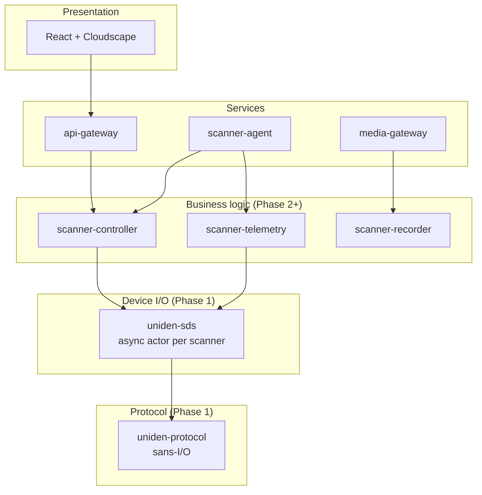
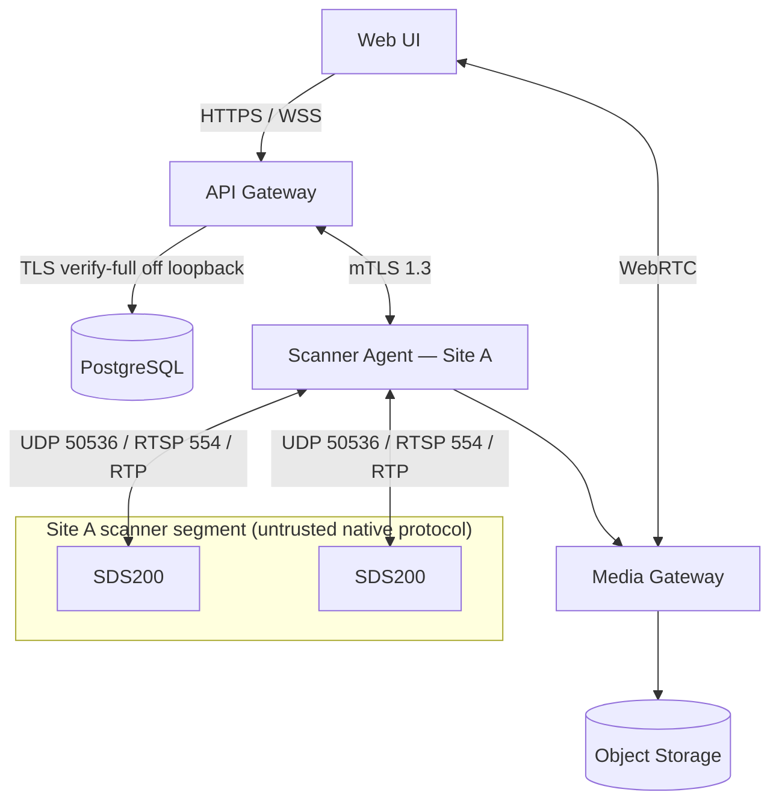
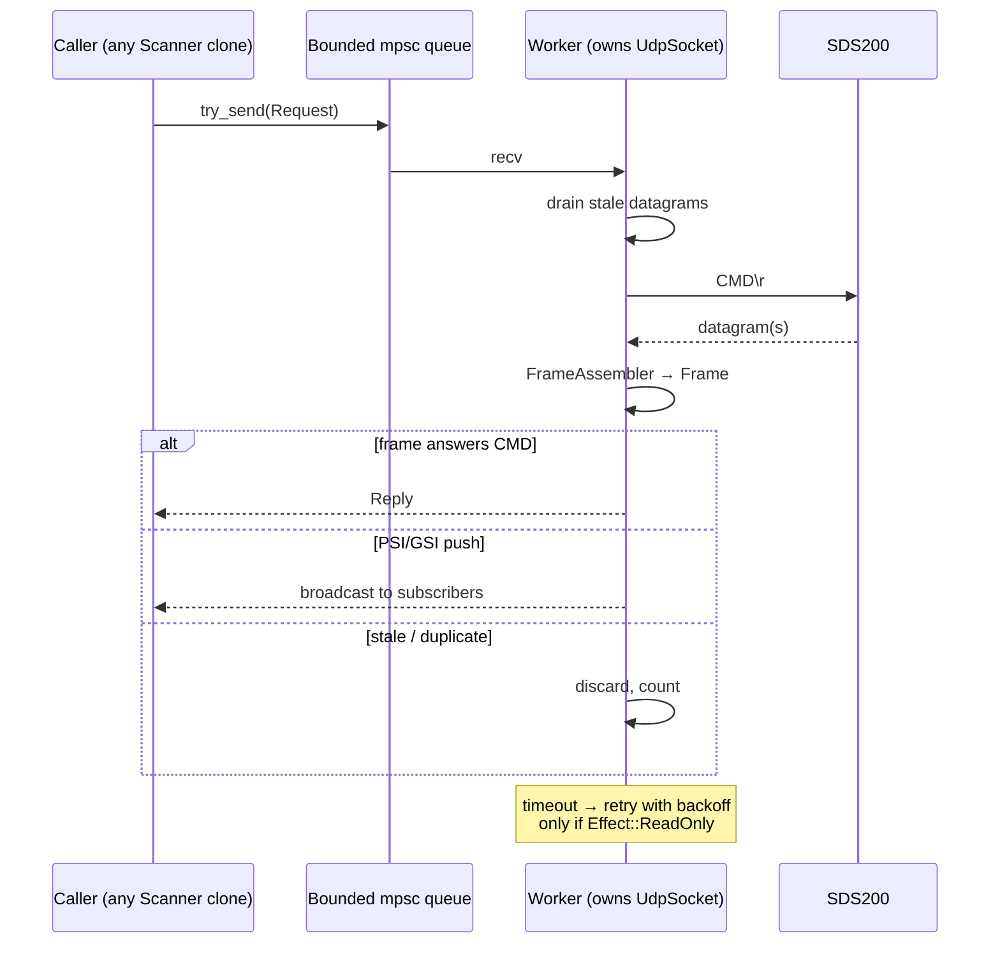
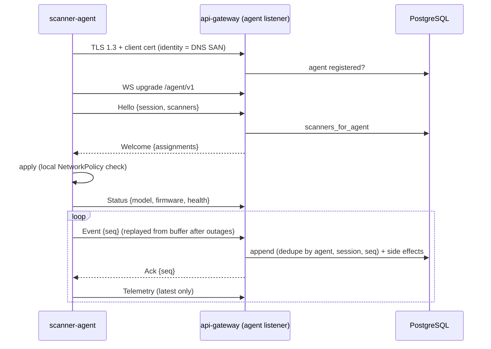

# Architecture

## Layering

The design separates four layers: the protocol codec, device I/O, business
logic and presentation.



The distributed deployment, with an agent at each site, a central API and
media gateway, and scanners on isolated segments, follows the project
specification diagram. It is reproduced here with the trust boundaries
marked:



## SDK internals (`uniden-sds`)



Key properties:

- **One command in flight per scanner.** The protocol has no request IDs,
  so serialization is what makes correlation by command name sound.
- **One receiver model.** Each physical scanner is a single receiver. The
  SDK never represents it as receiving more than one transmission at a
  time.
- **Bounded everything:**
  - the request queue (`queue_depth`);
  - the receive buffer (`max_datagram`);
  - reassembly (`FrameLimits`);
  - XML (`XmlLimits`);
  - the push channel (`push_capacity`).

ADRs are in [decisions/](decisions/).

## Phase 2: distributed management

| Crate / service | Responsibility |
|---|---|
| `platform-common` | IDs, telemetry and event types, `ScannerCommand`, `NetworkPolicy`, agent wire protocol |
| `scanner-telemetry` | GSI/PSI → `TelemetrySnapshot`; single-receiver transmission detector; async collector (push with poll fallback) |
| `scanner-controller` | Agent-side `ScannerRegistry` (reconcile, policy check, per-scanner SDK actor + collector); command mapping; `LeaseManager` |
| `platform-auth` | OIDC/JWKS verification → `Principal`; ABAC (tenant, site scope, permission, expiry) |
| `platform-storage` | `Store` trait; `PgStore` (sqlx 0.9, static SQL) and `MemoryStore` |
| `api-gateway` | REST + live WebSocket (OIDC), agent listener (mTLS), agent hub, leases, audit, rate limiting, OpenAPI |
| `scanner-agent` | Registry + collectors + bounded outage buffer + reconnecting mTLS session |

### Agent session



### Command path

```mermaid
sequenceDiagram
    participant U as Operator
    participant G as Gateway
    participant A as Agent
    participant S as SDS200
    U->>G: PUT /scanners/{id}/volume + Bearer + X-Lease-Id
    G->>G: OIDC verify → ABAC (tenant, site, scanner_control) → lease check
    G->>A: Execute {request_id, command}
    A->>S: VOL,12\r (serialized per scanner; never retried)
    S-->>A: VOL,OK
    A-->>G: CommandResult
    G->>G: audit (success/failure)
    G-->>U: 200
```

## Multiple gateway replicas (ADR 0008)

```text
 agent ──mTLS WS──► replica A ◄──── LISTEN/NOTIFY ────► replica B ◄── browser / REST
                        │      (presence, forwarded         │
                        │       requests, live, config)     │
                        └───────────► PostgreSQL ◄──────────┘
                               (records, leases, spill)
```

- **Agent connections.** An agent is connected to exactly one replica.
  Every replica learns where each agent is from presence messages, sent
  every 5 s and on change.
- **Requests.** `AgentHub::request` runs a command or discovery locally if
  the agent is here, and otherwise forwards it to the owner and waits for
  the outcome. Policy (authorization, leases, audit) is applied before
  forwarding, on the receiving replica.
- **Live updates.** Updates from local agents go to local WebSocket
  subscribers and onto the bus. Other replicas re-publish them locally.
- **Leases** are rows in `scanner_leases`, so every replica agrees on the
  holder.

## Agent durability

With `state_dir` set, the agent's outage buffer writes through to an
append-only journal:
- events are fsynced, acknowledgements are not;
- the journal is compacted atomically;
- the session id is persisted, so after a restart the agent resumes the
  same session id and sequence numbers, and the gateway's
  `(agent, session, seq)` de-duplication stays correct.

## Phase 3: audio (ADR 0009)

```text
scanner ──RTSP/RTP PCMU──► agent (single client, on demand)
                            │ µ-law → Opus 20 ms
                            ▼ binary frames on the mTLS WebSocket
                         gateway replica holding the agent
                          ├─ MediaHub ──► WebRtcServer ──DTLS-SRTP──► browsers (WHEP)
                          └─ recorder: events + frames → segments → Ogg Opus → S3
```

- **Demand.** The first listener on a replica sends `Audio{listen:true}` to
  the agent, and the last one leaving sends `false`. Scanners that record
  stream continuously while the agent is connected.
- **Agent workers.** One per audio-enabled scanner:
  - checks the local policy;
  - waits out the cooldown or backoff;
  - runs one RTSP session;
  - lingers after demand ends;
  - reports `AudioState`, which reaches the console as live `audio`
    events.
- **Recording** uses the agent's clock for both frames and transmission
  events. An object is written only when audio arrived.

## Phase 5: transcription, search, retention (ADR 0010)

```text
recorder ──stores Ogg──► S3 ──┐
   └─ set_transmission_audio(transcribe) → transmissions.transcription_state = pending
worker (each replica) ── claim (FOR UPDATE SKIP LOCKED, lease) ─┘
   → fetch recording → decode to 16 kHz WAV → Whisper-compatible service
   → finish: done / retry with backoff / failed / skipped
retention sweeper (each replica): delete objects → detach keys → expire transcripts
   → delete old transmissions and events → one audit record per tenant
```

- **Queue on the row.** Job state, attempts, the next attempt time and a
  claim lease are columns of `transmissions`, so no separate queue service
  is needed and jobs survive restarts. A claim that is never finished
  expires and is picked up again.
- **Search.** `transcript_tsv` is a generated `tsvector` (`simple`
  configuration) with a GIN index; `q` uses `websearch_to_tsquery`.
- **Analytics.** Two aggregate queries (`date_trunc` buckets in UTC and a
  grouped ranking). The API fills empty buckets.

## Phase 4: web console

```text
Browser ── HTTPS (same origin) ──► api-gateway public listener
  │  GET /             → frontend/dist (CSP, SPA fallback)
  │  GET /ui-config.json → public OIDC client settings
  │  /api/v1/*         → REST (Bearer access token)
  │  WS /api/v1/events/stream (token as subprotocol)
  └── OIDC code + PKCE ──► identity provider
```

- **One live stream per tab.** `LiveProvider` holds a single WebSocket and
  reduces messages into shared state:
  - the latest telemetry per scanner;
  - open transmissions, at most one per scanner;
  - health;
  - the last 200 events.

  Bursts are batched into one render per animation frame. Pages read this
  state, so no page polls for telemetry.
- **Directory.** Sites, scanners and agents are refreshed every 15 s. Agent
  connectivity is not on the live stream, so this refresh is what notices
  an agent going offline.
- **Freshness.** Agents send telemetry when it changes and as a heartbeat
  every 30 s. The UI therefore treats a snapshot as stale only after 45 s,
  or when the scanner or agent is offline.
- **Control.** `useLease` acquires a 300 s lease, renews it every 120 s
  while the page is open, and releases it on navigation or `pagehide`. It
  notices revocation when a scanner view fetched after acquisition no
  longer shows the caller as holder, or when a renewal fails. Commands
  carry `X-Lease-Id`. Sliders send the latest value once input settles, one
  request at a time.
- **Authorization in the UI** is advisory: `/me` decides which controls to
  render, and the gateway re-checks every call.
- **Development stack.** `radio-devstack` runs the real gateway, agents and
  simulators in one process, enrolls through the public API, and plays
  invented traffic. With `--ui-dir` it serves the built UI; otherwise the
  Vite dev server proxies to it.
