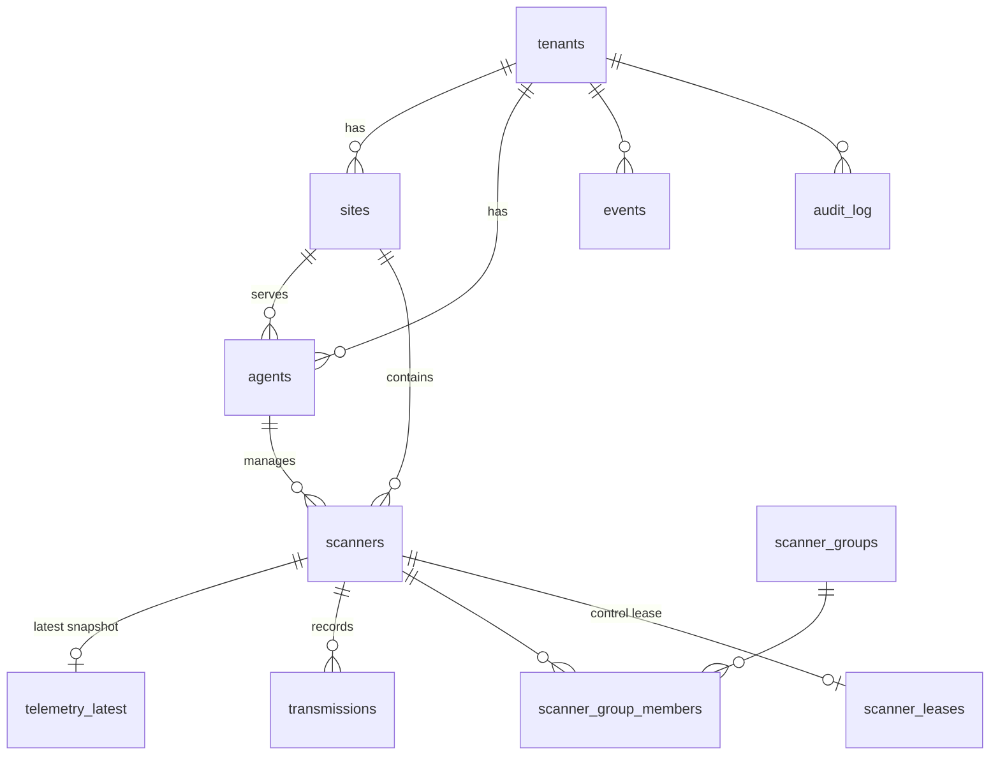

# Database Design

The schema lives in `migrations/` and is applied automatically at gateway
start-up. All tables are tenant-scoped, and metadata a scanner does not
report is nullable.

The gateway connects only after its database transport policy accepts the
URL: off loopback it requires `sslmode=verify-full` (ADR 0012,
`docs/deployment.md`, "Database TLS"). The cluster bus `LISTEN` connection
comes from the same pool. No schema change comes with this.

| Table | Purpose | Key constraints |
|---|---|---|
| `sites` | Locations and their authorized scanner networks (`allowed_networks TEXT[]`) | unique `(tenant_id, name)`; coordinate ranges |
| `agents` | Registered agent identities (certificate DNS SAN) | id pattern `[A-Za-z0-9._-]{1,128}` |
| `scanners` | Enrolled scanners (`host INET`, `port`); audio settings `audio_enabled`, `recording_enabled`, `rtsp_port` (migration 0003); `transcription_enabled` (migration 0004) | unique `(agent_id, host, port)`; `ON DELETE RESTRICT` from agents; `recording_needs_audio` and `transcription_needs_recording` checks; all flags default false |
| `telemetry_latest` | Latest snapshot as JSONB; never overwritten by an older snapshot | |
| `events` | Sequenced agent events | unique `(agent_id, agent_session, agent_seq)` de-duplicates replays |
| `transmissions` | Detected transmissions | `audio_object` holds the recording's storage key when recorded. Transcription: `transcript`, `transcription_state` (`pending`, `done`, `failed`, `skipped`), `transcription_attempts`, `transcription_next_at`, `transcription_locked_until` (the queue and its claim lease), `transcription_error`, `transcript_language`, `transcript_model`, `transcribed_at`. `hold` exempts the row from retention. `transcript_tsv` is a generated `tsvector` (GIN index) for full-text search |
| `audit_log` | Operator actions, including denials | `outcome IN ('success', 'denied', 'failure')`. Migration 0005: `seq`, `prev_hash`, `hash` (per-tenant SHA-256 chain, ADR 0011; unique `(tenant_id, seq)`); a trigger rejects `UPDATE` and `DELETE` |
| `audit_chain_heads` | Newest link of each tenant's audit chain | Locked `FOR UPDATE` by every append, which serializes a tenant's appends across replicas |
| `scanner_groups`, `scanner_group_members` | Configurable groups | |
| `scanner_leases` | Operator control leases, shared by all gateway replicas (migration 0002, ADR 0008) | one row per scanner; acquire and renew are one atomic upsert; expired rows purged every 30 s |
| `cluster_bus_spill` | `UNLOGGED`. Cluster-bus payloads too large for `NOTIFY` | rows purged after 5 minutes |

Indexes support the API filters:
- events and audit: `(tenant_id, id DESC)`;
- transmissions: `(tenant_id, started_at DESC, id DESC)`, frequency and
  TGID; the transcript GIN index; a partial index on
  `transcription_next_at` for pending jobs; `started_at` for retention;
- events: `received_at` for retention (migration 0004).

Retention (ADR 0010) deletes in batches of 500 rows, at most 40 batches per
step per sweep.

Not yet implemented:
- per-tenant retention policies;
- partitioning of `events` and `transmissions` (Phase 6).
