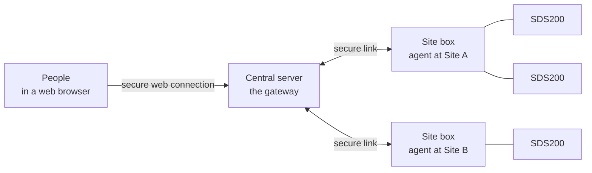

# How it works

Radio Platform has three main parts. You only ever see the first.

## 1. The web console

A website your organisation hosts. You sign in with your normal work
account (single sign-on), and what you can see and do depends on the role
you have been given.

## 2. The central server (gateway)

One central service that everyone's browser connects to. It:

- checks who you are and what you are allowed to do;
- keeps the list of sites, scanners and history in a database;
- passes commands to the right site, and passes updates back to you;
- writes every action to the audit log;
- if switched on, stores recordings and produces transcripts.

## 3. The site box (agent)

A small computer, for example a Raspberry Pi-class device, installed next
to the scanners at each site. It is the only thing that talks to the
scanners directly.

The site box **calls out** to the central server. Nothing on the internet
needs to be able to reach into the site, which keeps the scanners hidden.
If the connection drops, the site box keeps watching the scanners and
sends what it saw once the link is back.

## A day in the life of a command

When an operator turns up the volume on a scanner:

1. The browser sends the request to the central server.
2. The server checks the operator is signed in, has permission for that
   site, and currently "holds" control of that scanner (see below).
3. The server forwards the command to the right site box.
4. The site box sends it to the scanner and reports the result.
5. The server records the action in the audit log and tells the browser.

## One person in control at a time

A scanner can only be tuned one way at a time, so only one person may
control it at once. Taking control is called taking a **lease**. While
you hold it, others can watch and listen but not change the scanner. The
lease ends when you leave the page, or after a few minutes if you stop
using it. Administrators can take it back if needed.

## Why scanners stay on their own network

The scanners' own network connection has **no password and no
encryption**. Anyone who can reach a scanner on the network can control
it. That is why the platform keeps scanners on a separate, private
network segment at each site, with only the site box allowed to talk to
them.
