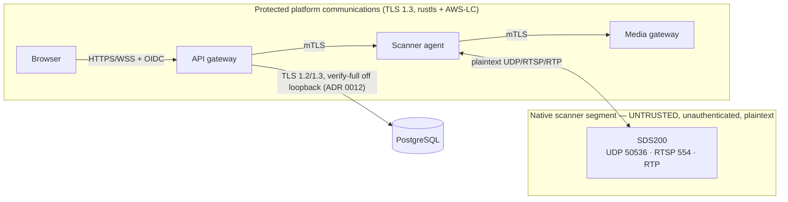

# Security Architecture

Control-by-control evidence and open gaps (POA&M) are in
[nist-800-53-controls.md](nist-800-53-controls.md).

## Trust boundary

- **Everything left of the agent** will be authenticated and encrypted
  (Phase 2).
- **Everything between the agent and a scanner** is plaintext and
  unauthenticated by design of the device. The controls here are network
  isolation, agent allow-lists of scanner network ranges (which also
  prevent SSRF through enrollment), connected UDP sockets, strict parsing
  and bounded resources.
- Scanner ports must never be exposed to the public Internet.
- **The gateway–PostgreSQL link** carries database credentials, audit
  records, transcripts, leases and cluster-bus messages. The "TLS 1.3"
  above applies to the gateway listeners and the agents only. The database
  link uses rustls with AWS-LC at **TLS 1.2 or 1.3** (sqlx cannot require
  1.3; operators set `ssl_min_protocol_version = 'TLSv1.3'` on the server).
  Off loopback the gateway refuses to start unless the URL is
  `sslmode=verify-full`; loopback and Unix-socket databases are inside the
  host and need no TLS. The explicit opt-out `[database]
  insecure_transport` (Helm `database.insecureTransport`) moves the link
  outside the protected boundary and is warned at every start. The
  database server and anyone holding its credentials remain inside the
  trust boundary (the cluster bus, ADR 0008, is unauthenticated within
  it).

## Controls implemented in Phase 1

| Control | Where |
|---|---|
| Bounded reassembly (lines, fields, XML bytes, parts) | `FrameLimits` |
| XML: no DTD; depth, element, attribute and value limits | `XmlLimits`, `xml::parse_documents` |
| Source-address filtering | Connected `UdpSocket` in `Scanner::connect` |
| Argument validation (no CR, LF or comma injection) | `Arg::new`, `KeyCode::new`, `RawCommand::new` |
| No automatic retry of writes | `Effect`, `worker::execute_inner` |
| Bounded command queue | `ScannerConfig::queue_depth` |
| No panics on untrusted input | Clippy lints, proptest, cargo-fuzz |
| `unsafe` forbidden | Workspace lints |

## Controls implemented in Phase 2

| Control | Where |
|---|---|
| TLS 1.3 only (rustls + AWS-LC) for public API, agent listener and agent client | `api_gateway::tls`, `scanner_agent::tls` |
| Mutual TLS for agents; identity from cert DNS SAN; must be registered | `tls::mtls_server_config`, `agent_ws::agent_socket` |
| OIDC bearer verification (JWKS, asymmetric algorithms only, iss/aud/exp/nbf, max session age) | `platform_auth::OidcVerifier` |
| ABAC: tenant, site scope, permission, expiry; cross-tenant → 404 | `platform_auth::Principal::authorize` |
| Tenant scoping at the storage boundary | `platform_storage::Store` |
| SSRF prevention: site network allow-lists at enrollment **and** agent-local policy | `NetworkPolicy`, ADR 0005 |
| Exclusive control leases in the shared store (atomic upsert); read-only for everyone else | `Store::acquire_lease`, `api_gateway::leases`, ADR 0008 |
| Raw commands restricted to `scanner_admin`, validated, never retried | `ScannerCommand::requires_admin`, `RawCommand` |
| Audit of operator actions including denials | `AppState::audit`, `audit_log` |
| Per-subject rate limiting, body limits, timeouts, connection caps, handshake timeouts | `state.rs`, `lib.rs`, `serve.rs` |
| Bounded agent buffers and message sizes (1 MiB) | `wire::MAX_MESSAGE_BYTES`, `Buffer` |
| SQL injection prevention: static SQL enforced by sqlx 0.9 | ADR 0007 |
| Agent identity cannot be claimed by another tenant | `sites::register_agent` |
| Agent certificate revocation: strict CRL checking (revoked, unknown or expired CRL refused), hot reload, forced re-verification | `tls::mtls_server_config_with_crls`, `crl::CrlReloader` |
| Per-IP rate limiting before authentication; `X-Forwarded-For` honoured only from configured proxies, right-most untrusted hop | `state::ip_rate_limit`, `state::client_ip` |
| Discovery checked twice: site networks and allowed ports at the gateway, agent-local policy at the agent; 1024-host cap; pacing; read-only `MDL` only; enrolled and managed endpoints never probed; `scanner_manage` required; audited | `api::discovery`, `scanner_agent::discovery` |
| Groups: create and delete need access to every site; membership is authorized by the scanner's site; listings hide out-of-scope members | `api::groups` |
| Durable agent journal private to the service user (`0700`/`0600`) | `scanner_agent::journal` |
| Agent protocol negotiation: v1 agents are never sent v2 messages | `hub::AgentOp::min_protocol` |

## Controls implemented in Phase 3 (audio)

| Control | Where |
|---|---|
| Audio and recording off by default (gateway config **and** per scanner); recording needs `recording_manage` and audio | `[media]`/`[recording]`, `scanners.audio_enabled`/`recording_enabled`, `api::scanners::update` |
| Listening needs `audio_listen` at the scanner's site; playback needs `audio_listen` + `event_view`; both audited | `api::audio` |
| RTSP endpoints checked against the gateway's `audio_ports` and the agent's local `audio_ports` + networks | `NetworkPolicy::check_audio` |
| Single RTSP client, on demand, `TEARDOWN` always, cooldown and backoff, no probes | `scanner_audio::client`, `scanner_agent::audio` (ADR 0009) |
| RTP accepted only from the scanner IP with PT 0; bounded RTSP/SDP parsing; control URL must stay on the scanner's host; fuzzed | `scanner_audio::{rtp, rtsp}`, fuzz targets |
| Media frames accepted only for scanners assigned to the sending agent; strict binary codec (fuzzed) | `agent_ws`, `wire::media` |
| WebRTC with DTLS-SRTP (AWS-LC), Opus only, session limits per replica and per user, creator-or-admin hang-up | `media_gateway::webrtc`, `media::Media::listen` |
| Recording keys contain only UUIDs and dates; credentials from the environment; no-store playback | `scanner_recorder::store` |
| CSP extended only with `media-src 'self' blob:` | `api_gateway::ui` |

## Controls implemented in Phase 6 (hardening)

| Control | Where |
|---|---|
| Route-by-route authorization test: every documented route needs exactly its listed permissions (each one shown necessary), refuses missing tokens and never serves another tenant; new routes fail the test until listed | `tests/authz_matrix.rs` |
| Tamper-evident audit log: per-tenant SHA-256 hash chain (AWS-LC), atomic head update, append-only trigger, `/audit/verify`, hourly head logging for external anchoring | ADR 0011, `audit_chain`, migration 0005 |
| Audited, filterable audit export (needs `export` too) with hashes for offline verification; CSV formula neutralisation | `api::audit` |
| Metrics on a separate unauthenticated listener, warned when not on loopback; labels use route templates, never identifiers | `metrics.rs`, `tests/metrics.rs` |
| Graceful shutdown on SIGTERM (Kubernetes, systemd) | both `main.rs` |
| `--check-config` and start-up validation of listener, TLS, cluster, transcription and retention settings | `GatewayConfig::validate` |
| Distroless non-root images; SBOM, provenance and cosign signatures; native multi-arch builds | `deployments/container`, `images.yml` |
| Helm: restricted pod security (non-root, read-only root, no capabilities, seccomp), no service-account token, NetworkPolicy (metrics only from monitoring), PDB, values schema, chart-owned security settings | `deployments/helm/radio-platform` |
| Sandboxed agent unit (dynamic user, no capabilities, strict filesystem, syscall filter) | `deployments/systemd` |
| Database transport (ADR 0012): TLS to PostgreSQL with rustls + AWS-LC (TLS 1.2 or 1.3); off loopback only `sslmode=verify-full` is accepted (`verify-ca`, `require`, `prefer` and plaintext refused) unless `[database] insecure_transport`, which is off by default and warned; destination decided by `hostaddr` when set; loopback decided lexically; enforced in `--check-config` and before connecting; the connect path accepts only a policy-checked target and re-checks it against sqlx; URL and password never logged or echoed | `platform_storage::pg_transport` (`PgTarget::check`, `CheckedTarget`), `PgStore::connect_target`, `GatewayConfig::check_database_transport` |
| Configuration parse errors give the message and line and column only, never the source line (which may hold the database password) | `config::parse_toml` (gateway and agent) |
| Nightly fuzzing of every target with a persistent corpus; seeds in `fuzz/seeds` | `fuzz-nightly.yml` |

## Controls implemented in Phase 5 (transcription, search, retention)

| Control | Where |
|---|---|
| Transcription off by default (gateway `[transcription]` **and** per scanner); enabling it needs `transcription_manage` and recording | `api::scanners::update`, `scanners.transcription_enabled` (DB check constraint) |
| Endpoint must be HTTPS unless loopback or `allow_http`; no credentials in the URL; API key only from an environment variable; redirects never followed; responses capped at 1 MB; warning logged when audio leaves the host | `scanner_transcription::{config, client}`, `main.rs` |
| Transcripts treated as content: removed from responses without `audio_listen`; text search needs `audio_listen` and is audited; re-transcription audited | `api::history::redact`, `api::records` |
| Transcript text sanitised (control characters removed, whitespace collapsed, 16 kB cap) and rendered as text, never HTML | `clean_text`, `TransmissionDetail.tsx` |
| Recordings read back from storage are parsed with checksums and size limits before decoding (fuzzed) | `scanner_audio::ogg::read_ogg_opus`, `decode_ogg_opus`, fuzz target `ogg_opus` |
| Transcription retries only on transient failures, with backoff and an attempt cap; the job is not a scanner command | `api_gateway::transcription` |
| Retention: object deleted before the key is cleared (only if unchanged and not held); held transmissions exempt; one `system:retention` audit record per tenant per sweep; the audit log is never swept | `api_gateway::retention`, `Store::clear_transmission_audio` |
| Holds and manual deletion need `recording_manage`; deletion refused while held; both audited | `api::records` |
| Analytics windows bounded (31 days hourly, 366 daily); site scope applied; ranking columns chosen from a fixed list, never from input | `api::analytics`, `PgStore::transmission_top` |

Known limitations:
- Retention is global, not per tenant or per site.
- The worker stores whatever text the service returns; the platform
  cannot detect invented text beyond skipping very short recordings.

## Controls implemented in Phase 4 (web console)

| Control | Where |
|---|---|
| OIDC authorization code + PKCE as a public client (no secret in the browser) | `frontend/src/auth/session.ts` |
| Access tokens held in memory only (`InMemoryWebStorage`); only the transient PKCE state uses sessionStorage | `OidcSession` |
| Strict CSP: `script-src 'self'`, connect only to self and the IdP, `frame-ancestors 'none'`, `base-uri 'none'`; no inline scripts in the build | `api_gateway::ui` |
| `nosniff`, `X-Frame-Options: DENY`, `no-referrer`, COOP, Permissions-Policy on every response; `no-store` on API responses; HSTS when the gateway terminates TLS | `api_gateway::with_ui` |
| UI hides controls the caller lacks (`/me`), but the server authorizes every request | `GET /api/v1/me` |
| No automatic retry of state-changing requests; volume and squelch are debounced and serialized | `ApiClient`, `useSettledCommand` |
| Lease released on page leave (`pagehide`, keepalive) and renewed only while the page is open | `useLease` |
| Export neutralises spreadsheet formula injection | `csvField` |
| React escaping for all scanner-supplied text (display, popups, names); no `dangerouslySetInnerHTML` | `frontend/src` |
| Dependencies pinned exactly; install scripts disabled; `npm audit` in CI | `frontend/.npmrc`, CI `frontend` job |
| `/dev/token` exists only in `radio-devstack`, which binds loopback only; the gateway returns 404 for `/dev/*` | `tests/devstack`, `ui.rs` test |

Notes:
- `style-src` allows `'unsafe-inline'`, because the component library sets
  inline styles. Scripts remain same-origin only.
- On the live stream the token travels in `Sec-WebSocket-Protocol`. Make
  sure proxies do not log that header.

Known limitations:
- Audit-write failures are logged but do not block the action.
- No OCSP; revocation is CRL-only and only for agent certificates.
- The cluster bus is unauthenticated within the database trust boundary
  (ADR 0008).
- Database link (POA&M item 3): `sslrootcert` adds to the built-in public
  roots instead of replacing them; TLS 1.2 is accepted; no client
  certificate; a database CA change needs a gateway restart; the
  `insecure_transport` opt-out exists. The real TLS test runs only in CI
  and has not yet run on GitHub Actions.

Planned:
- non-root, read-only containers;
- SBOMs;

No FIPS compliance is claimed.
